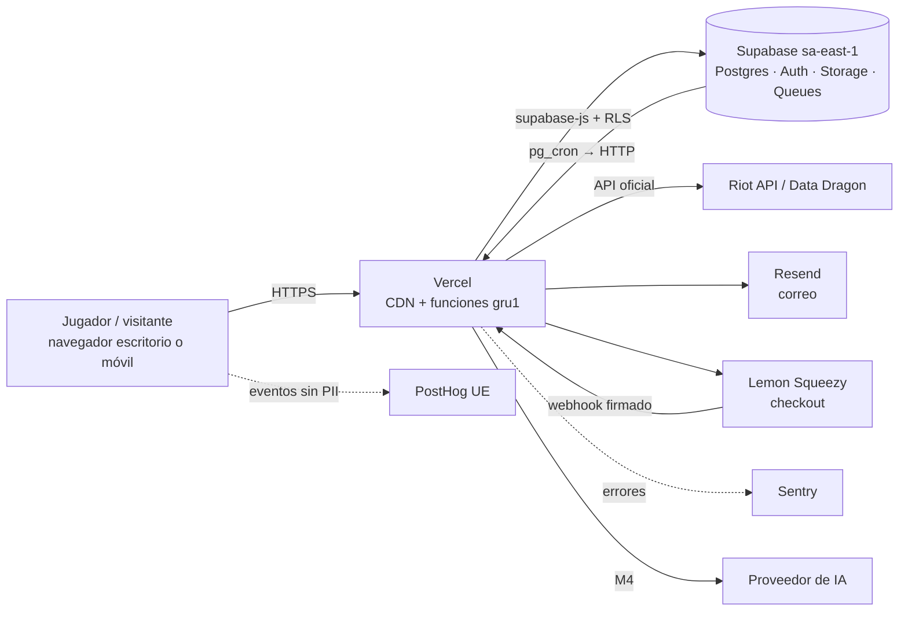

# ADR-0003: Topología de despliegue: Vercel + Supabase en São Paulo

- **Estado:** Aceptado (el paso a Supabase Pro queda **Propuesto** para M3)
- **Fecha:** 2026-10-27
- **Fase:** Validación y Producto
- **Requisitos:** RES-15, RES-21, RES-23, RNF-07, RNF-16, RNF-24, RNF-26, D-06, D-10

> **Nota (2026-10-28):** lo que este ADR decide sobre Supabase está reemplazado por [ADR-0014](0014-neon-como-base-de-datos.md) (Neon), por falta de presupuesto. El resto sigue vigente.

## Contexto
- El presupuesto es casi cero durante la validación y ≤ US$60–80 al mes en el producto (RES-15).
- Solo web responsive (D-06). El público está en LAS, LAN y España (RES-21); la mayoría está en Latinoamérica.
- No hay tiempo para operar servidores (RNF-26).
- Jorge elige Vercel, su stack habitual: plan Hobby al inicio y Pro al momento de cobrar.

## Decisión
### Componentes
| Componente | Servicio | Región | Plan |
|---|---|---|---|
| App web (páginas, Server Actions, API, cron) | Vercel | Funciones en `gru1` (São Paulo); estáticos en la CDN global | Hobby → **Pro antes de activar el cobro** |
| Base de datos, Auth, Storage, colas y `pg_cron` | Supabase | `sa-east-1` (São Paulo) | Free → Pro en M3 (Propuesto) |
| Correo transaccional | Resend | — | Gratis |
| Anti-bots en formularios públicos | Cloudflare Turnstile | — | Gratis |
| Pagos (Merchant of Record) | Lemon Squeezy (ADR-0009) | — | Comisión por venta |
| Analítica de producto | PostHog Cloud | UE | Gratis |
| Errores | Sentry | — | Gratis (Developer) |
| Disponibilidad | UptimeRobot | — | Gratis |
| Datos de juego | Riot API + Data Dragon (CDN) | — | Gratis |
| IA (M4) | Proveedor detrás de una interfaz (ADR-0008) | — | Pago por uso |
| DNS y dominio | Registrador a elección | — | ~US$10–15 al año |

### Plan de Vercel
- **Hobby** mientras se desarrolla y mientras la landing junta la lista de espera.
- **Pro (US$20 al mes) antes de activar cualquier cobro**, es decir, antes del issue #9 (pre-venta, sprint 4).
- ⚠️ Los términos de Hobby lo limitan a uso personal y **no comercial**. Una landing que capta clientes para un producto de pago ya roza ese límite. Jorge acepta el riesgo; si Vercel lo notifica, se adelanta el paso a Pro.

### Supabase en plan Free
- Se pausa después de 7 días sin actividad → un **cron diario de latido** (Vercel Cron, que en Hobby permite una ejecución al día) consulta la base.
- No incluye respaldos descargables → un **respaldo nocturno propio**, cifrado y retenido 30 días (D-10), con un workflow de GitHub Actions (ADR-0010).
- Se pasa a **Pro (US$25 al mes)** cuando ocurra lo primero de esto: hay datos sensibles de usuarios reales (M3), la base pasa de ~400 MB o se necesita restauración a un punto en el tiempo.

### Ambientes
| Ambiente | Web | Base de datos |
|---|---|---|
| Local | `next dev` | Supabase CLI en Docker (`supabase start`) con datos sembrados |
| Preview (por PR) | Despliegue preview de Vercel | Proyecto Supabase **staging** (gratis) con datos sintéticos |
| Producción | `main` → Vercel producción | Proyecto Supabase **prod** |

> Verificar el cupo de proyectos gratuitos activos en Supabase (suele ser 2 por cuenta). Si otros proyectos lo ocupan, se pausa uno de ellos o los previews usan solo datos simulados.

### Costo esperado
| Etapa | Fijo mensual | Variable |
|---|---|---|
| M1 Captación | ~US$1 (dominio prorrateado) | — |
| M2 Pre-venta | ~US$21 (Vercel Pro + dominio) | ~5% + US$0,50 por venta |
| M3–M4 Producto | ~US$46 (+ Supabase Pro) | IA ≤ US$0,40 por usuario premium (RNF-23) |

Todo queda dentro de RES-15 (US$60–80).

## Alternativas consideradas
| Alternativa | Por qué no |
|---|---|
| Cloudflare Pages/Workers (gratis y con uso comercial permitido) | Next.js corre ahí mediante un adaptador, con fricciones; Jorge prefiere Vercel. **Plan B** si el costo de Vercel Pro pesa |
| VPS propio (Hetzner, DigitalOcean) | Barato, pero hay que operar el SO, los parches y los respaldos (va contra RNF-26) |
| Render o Fly con plan gratuito | Arranques en frío y servicios que se duermen; no aportan sobre Vercel |
| Región UE (Fráncfort) | Mejor para España, pero peor para la mayoría latinoamericana |

## Consecuencias
- **Positivas:** costo ~0 en la validación; despliegue automático por PR; nada que operar a nivel de servidor; la web y la base están en la misma región.
- **Negativas / costos:**
  - Hay que mantener vivo Supabase Free y hacer respaldos propios.
  - Los datos de usuarios de España se alojan en Brasil: es una **transferencia internacional** bajo el RGPD. Requiere el DPA de Vercel y de Supabase (con cláusulas contractuales tipo) y declararlo en la política de privacidad (RNF-16).
  - Desde España hay ~200 ms de latencia hacia la API, aceptable porque nada es en tiempo real.
- **Revisar cuando:** el costo fijo supere US$60 al mes, Vercel objete el uso en Hobby o España pase a ser la mayoría de los usuarios.
